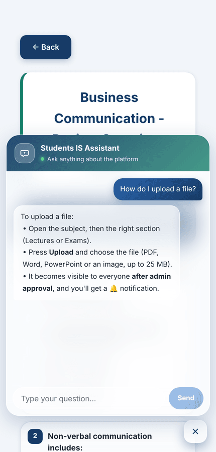
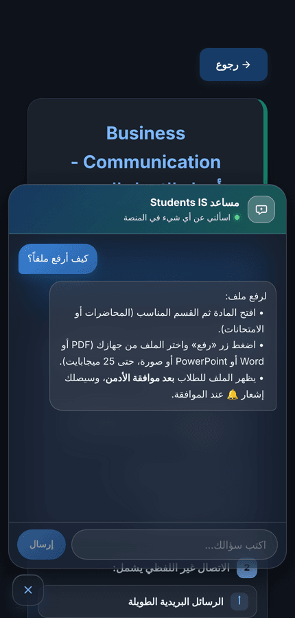
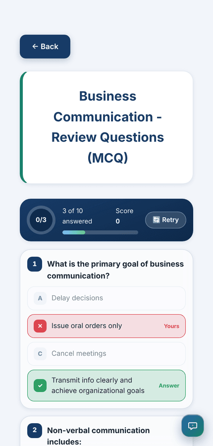
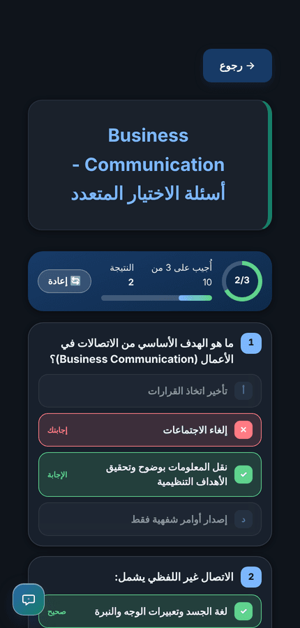

<div dir="rtl" align="right">

<div align="center">


# Students IS

**منصة تعليمية ثنائية اللغة للطلاب الجامعيين: المحاضرات والامتحانات وأسئلة المراجعة في مكان واحد.**

جامعة البيان · كلية علوم الحاسوب وتقانة المعلومات · قسم نظم المعلومات

[](https://computer-is-collage.netlify.app)

[English](README.md) · **العربية**

</div>

---

## نبذة

تجمع Students IS المواد الدراسية لقسم نظم المعلومات (محاضرات وشيتات وامتحانات وأسئلة مراجعة) في موقع واحد قابل للبحث ومناسب للهاتف. يسجّل الطالب دخوله ويجد ما يحتاجه ويتدرّب بأسئلة الاختيار من متعدد، ويستطيع رفع ملفات تظهر للجميع بعد موافقة الأدمن فقط.

## لقطات

<table>
  <tr>
    <td align="center"><br /><sub>المساعد الزجاجي (فاتح)</sub></td>
    <td align="center"><br /><sub>المساعد الزجاجي (ليلي)</sub></td>
    <td align="center"><br /><sub>أسئلة المراجعة (فاتح)</sub></td>
    <td align="center"><br /><sub>أسئلة المراجعة (ليلي)</sub></td>
  </tr>
</table>

## المميزات

**للطلاب**
- إنشاء حساب ودخول واستعادة كلمة المرور عبر Supabase Auth، والمنصة للطلاب المسجّلين فقط.
- مواد مرتبة حسب السمستر، ولكل مادة محاضرات وامتحانات وأسئلة مراجعة.
- **أسئلة المراجعة**: اختيار من متعدد بلغتين مع تغذية راجعة فورية وحلقة نتيجة وشريط تقدّم وخلط للخيارات.
- **بحث ذكي** يتحمل الأخطاء الإملائية ويفهم العربية (الهمزات والتاء المربوطة والتشكيل) والإنجليزية.
- **مساعد** بتصميم شبه زجاجي يجيب عن أسئلة المنصة ويجلب المحاضرات والامتحانات (مبني على قواعد، مع ترقية اختيارية بـ Claude عبر Edge Function).
- رفع الطلاب للملفات (تظهر بعد موافقة الأدمن) مع إشعار عند الموافقة.
- أدوات مذاكرة: مهام والمفضلة وعدّ تنازلي للامتحانات (محفوظة في المتصفح).
- واجهة عربية (RTL) وإنجليزية (LTR) ووضع ليلي.
- **قابلة للتثبيت كتطبيق (PWA)** مع صفحة عند انقطاع الإنترنت.

**للأدمن**
- لوحة أدمن محمية: مراجعة الملفات المرفوعة والموافقة والحذف والبحث عن الطلاب.
- **لوحة إحصاءات**: الدخول والملفات المفتوحة والطلاب النشطون مع مقارنة بالفترة السابقة، ونشاط يومي وساعات الذروة وأكثر المواد والملفات، وتصدير CSV. يُستثنى نشاط الأدمن افتراضياً حتى لا تشوّه التجارب الأرقام.

## التقنيات

| الطبقة | التقنية |
|---|---|
| الواجهة | Next.js 14 (App Router) + React 18، تصدير ثابت `output: "export"` |
| الحسابات والبيانات والتخزين | Supabase (Auth + Postgres + Storage) مع Row Level Security |
| الـ API | Supabase Edge Functions (Deno / TypeScript) |
| الاستضافة والنشر | Netlify، ويُنشر عبر GitHub Actions عند كل دفع إلى `main` |
| PWA | ملف Manifest وservice worker لنفس النطاق (ملفات ثابتة وصفحة انقطاع فقط) |

## التشغيل محلياً

```bash
npm install
npm run dev      # http://localhost:3000
npm run build    # ينتج مجلد out
```

إعداد قاعدة البيانات من Supabase SQL Editor: شغّل `supabase/schema.sql` ثم `supabase/stats.sql` و`supabase/stats_v2.sql` للإحصاءات.

## ابدأ من هنا

| أريد أن... | اقرأ |
|---|---|
| أجهّز المشروع لأول مرة (Supabase + Netlify) | [docs/SETUP.md](docs/SETUP.md) |
| أضيف مادة أو رابط أو أسئلة | [docs/EDITING.md](docs/EDITING.md) |
| أفهم أين يوجد كل ملف | [docs/STRUCTURE.md](docs/STRUCTURE.md) |
| أركّب الـ API (الإشعارات والمساعد) | [docs/API.md](docs/API.md) |
| أفهم الصلاحيات والحماية | [docs/SECURITY.md](docs/SECURITY.md) |
| أحل مشكلة ظهرت | [docs/TROUBLESHOOTING.md](docs/TROUBLESHOOTING.md) |
| أعرف ما تغيّر | [CHANGELOG.md](CHANGELOG.md) |

## المطورون

**مرتضى عيسى** و**عبدالله إسماعيل**، طلاب نظم المعلومات في جامعة البيان.

© 2026 جميع الحقوق محفوظة.

</div>
