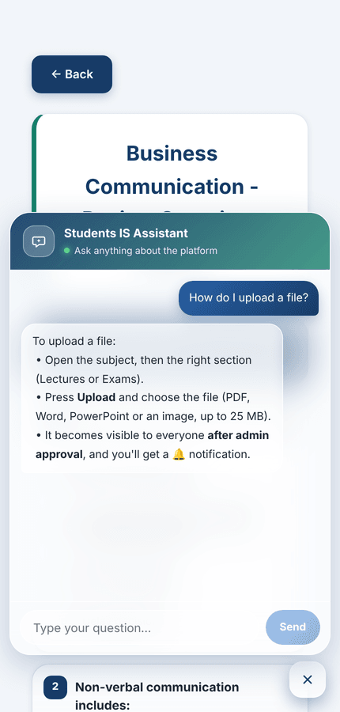
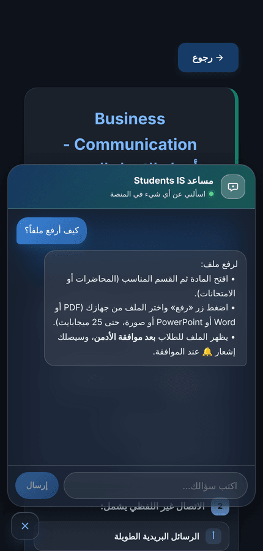
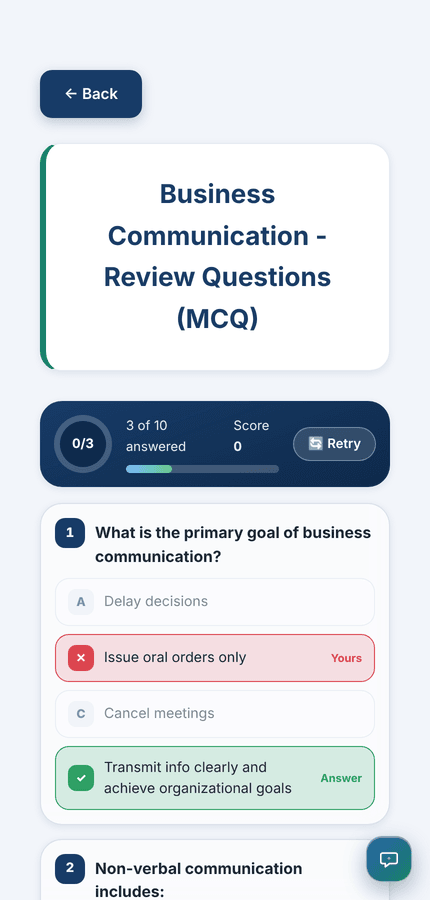
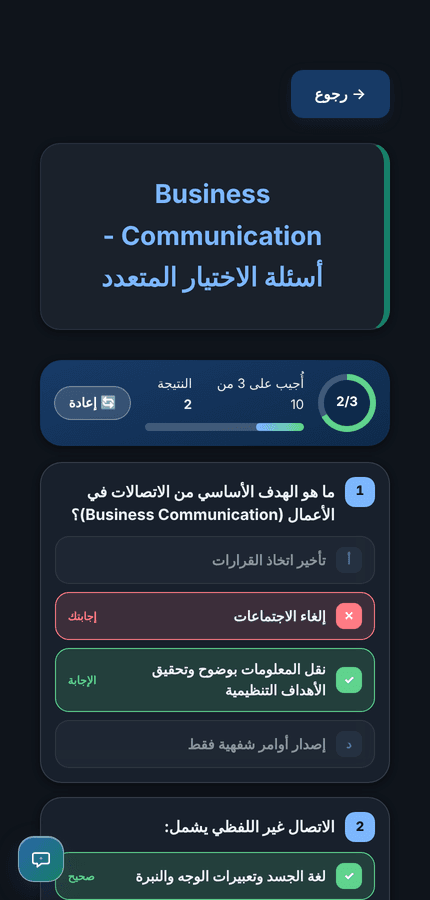
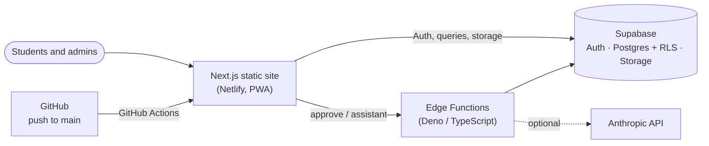

<div align="center">


# Students IS

**A bilingual study platform for university students: lectures, exams and review questions in one place.**

Al-Bayan University · College of Computer Science & Information Technology · Information Systems Department

[](https://computer-is-collage.netlify.app)


**English** · [العربية](README.ar.md)

</div>

---

## Overview

Students IS gathers the study material of the Information Systems department (lectures, sheets, exams and review questions) in a single, searchable, mobile-friendly site. Students sign in, find what they need, practice with multiple-choice questions and can contribute files, which appear for everyone only after an admin approves them.

## Screenshots

<table>
  <tr>
    <td align="center"><br /><sub>Glass assistant (light)</sub></td>
    <td align="center"><br /><sub>Glass assistant (dark, Arabic)</sub></td>
    <td align="center"><br /><sub>Review questions (light)</sub></td>
    <td align="center"><br /><sub>Review questions (dark, Arabic)</sub></td>
  </tr>
</table>

## Features

**For students**
- Sign up, sign in and password reset (Supabase Auth). The platform is open to signed-in students only.
- Subjects organized by semester, each with Lectures, Exams and Review Questions.
- **Review questions**: bilingual multiple choice with instant feedback, a score ring, a progress bar and shuffled options.
- **Smart search** that tolerates spelling mistakes and understands Arabic (hamza, taa marbuta, diacritics) and English.
- **Assistant**: a chat helper with a semi-glass design that answers platform questions and finds lectures and exams (rule-based, with an optional Claude upgrade through an Edge Function).
- Student uploads, published only after admin approval, with a notification when approved.
- Study tools: task list, favorites and an exam countdown (saved in the browser).
- Arabic (RTL) / English (LTR) interface and dark mode.
- **Installable as an app (PWA)** with a friendly offline page.

**For admins**
- Protected admin panel: review pending files, approve, delete and search students.
- **Analytics dashboard**: visits, files opened and active students with period-over-period comparison, daily activity, peak hours, top subjects and top files, CSV export. Admin activity is excluded by default so testing does not skew the numbers.

## Architecture



Security lives in **Row Level Security** on the database, not in the browser: roles are stored in `profiles` (`student` / `admin`), students can upload only into their own private folder, and Edge Functions verify the caller on the server. See [docs/SECURITY.md](docs/SECURITY.md) (Arabic) for the full permission table.

## Tech stack

| Layer | Technology |
|---|---|
| Frontend | Next.js 14 (App Router) + React 18, static export (`output: "export"`) |
| Auth, database, storage | Supabase (Auth, Postgres, Storage) with Row Level Security |
| Backend API | Supabase Edge Functions (Deno / TypeScript) |
| Hosting and deploy | Netlify, deployed by GitHub Actions on every push to `main` |
| PWA | Web App Manifest + a same-origin service worker (static assets and an offline page only) |
| Fonts | Inter, Sora, JetBrains Mono · Amiri, IBM Plex Sans Arabic, Cairo |

## Getting started

```bash
npm install
npm run dev      # http://localhost:3000
npm run build    # static site in ./out
```

Environment variables (see `.env.example`):

```
NEXT_PUBLIC_SUPABASE_URL=...
NEXT_PUBLIC_SUPABASE_KEY=...        # publishable key only
NEXT_PUBLIC_STORAGE_BUCKET=Twix
```

> Never put a `service_role` key or any API secret in the code or in `NEXT_PUBLIC_*` variables.

Database setup, in the Supabase SQL Editor: run `supabase/schema.sql`, then `supabase/stats.sql` and `supabase/stats_v2.sql` for the analytics.

## Project structure

```
src/
  app/            pages (home, subjects, login, admin) and global styles
  components/     UI: shell, search, assistant, questions, admin, notifications
  data/           editable content: subjects, file links, questions
  lib/            Supabase client, search engine, assistant logic
public/           manifest, icons, service worker, offline page
supabase/
  schema.sql, stats.sql, stats_v2.sql, notifications.sql
  functions/      Edge Functions (approve-submission, student-assistant)
docs/             setup, editing, security and API guides (Arabic)
.github/          deploy workflow, issue and pull request templates
```

## Documentation

Guides are written in Arabic.

| I want to... | Read |
|---|---|
| Set up the project for the first time | [docs/SETUP.md](docs/SETUP.md) |
| Add subjects, links or questions | [docs/EDITING.md](docs/EDITING.md) |
| Understand the file layout | [docs/STRUCTURE.md](docs/STRUCTURE.md) |
| Install the API and assistant | [docs/API.md](docs/API.md) |
| Understand permissions and security | [docs/SECURITY.md](docs/SECURITY.md) |
| Fix a problem | [docs/TROUBLESHOOTING.md](docs/TROUBLESHOOTING.md) |
| See what changed | [CHANGELOG.md](CHANGELOG.md) |

## Deployment

Pushing to `main` runs the GitHub Actions workflow (`.github/workflows/netlify-deploy.yml`), which builds the static site and deploys it to Netlify. The `NETLIFY_AUTH_TOKEN` and `NETLIFY_SITE_ID` secrets are stored in the repository settings.

## Contributing and security

Suggestions and bug reports are welcome: see [CONTRIBUTING.md](CONTRIBUTING.md). To report a security issue privately, see [SECURITY.md](SECURITY.md).

## Authors

**Murtda Eissa** and **Abdullah Ismail**, Information Systems students at Al-Bayan University.

© 2026 All rights reserved.
